# Agent Manager Flowchart & Call Architecture   
   
This document details the signal-to-slot architecture, call pathways, and state management flow for `agent_manager.py`. It serves as a structural map for developers and AI agents tracing functions, variable changes, and event cascades.   
   
## Architecture Overview   
   
`agent_manager.py` is event- and signal-driven via PyQt5. Interactions flow from:   
1. **User Actions** (selecting an agent, tweaking sliders, selecting a provider, saving presets).   
2. **Signals** (`currentTextChanged`, `clicked`, `valueChanged`, `itemSelectionChanged`).   
3. **Slot Handlers** (`_on_agent_selected`, `_on_provider_selected`, `_save_agent`, `_fetch_lms_models`).   
4. **Core Routines & Helpers** (`_load_agent_config`, `_populate_agents_list`, `_sync_preset_combobox`).   
5. **Persistence** (`ConfigManager.save_agent_config`, `ConfigManager.save_config`).   
   
> [!NOTE]   
> `self._is_loading` flag is toggled during programmatic loads (e.g., inside `_load_agent_config()`) to prevent auto-save feedback loops when widget values are set via code.   
   
---   
   
## Function Call & Signal Flowchart   

```mermaid
flowchart TD
    %% Node Classes
    classDef init fill:#2d3748,stroke:#4a5568,color:#fff
    classDef signal fill:#2b6cb0,stroke:#3182ce,color:#fff
    classDef core fill:#276749,stroke:#38a169,color:#fff
    classDef helper fill:#744210,stroke:#b7791f,color:#fff
    classDef ext fill:#4a5568,stroke:#718096,color:#fff

    subgraph Initialization ["🚀 Initialization & Bootstrap"]
        init["__init__(parent_app)"]:::init
        conn["_connect_signals()"]:::init
        pop_agents["_populate_agents_list()"]:::helper
        ref_prov["_refresh_providers()"]:::helper
        ref_pre["_refresh_preset_combobox()"]:::helper
        load_base_prompt["_load_base_agent_prompt()"]:::helper
    end

    subgraph Signals ["⚡ UI Signals & Events (User Actions)"]
        evt_agent_change["agent_combo.currentTextChanged"]:::signal
        evt_agent_create["pushButtonAgentsCreate.clicked"]:::signal
        evt_agent_del["pushButtonAgentsDelete.clicked"]:::signal
        evt_provider_click["listWidgetProviders.itemClicked / currentItemChanged"]:::signal
        evt_provider_add["pushButtonProvidersAdd.clicked"]:::signal
        evt_provider_rem["pushButtonProvidersRemove.clicked"]:::signal
        evt_slider_change["Sliders / SpinBoxes valueChanged"]:::signal
        evt_preset_select["comboBoxInferrancePreset.currentTextChanged"]:::signal
        evt_preset_save["pushButtonInferrancePresetSave.clicked"]:::signal
        evt_models_fetch["pushButtonModelsGoogle / Config / Provider / Loaded"]:::signal
        evt_tools_click["Quick Tools (SynBrain, LTM, STM)"]:::signal
        evt_prompt_item["listWidgetPrompts itemClicked / Changed"]:::signal
    end

    subgraph Handlers ["⚙️ Handlers & Core Logic"]
        on_agent["_on_agent_selected(agent_name)"]:::core
        load_agent["_load_agent_config(agent_name)"]:::core
        save_agent["_save_agent()"]:::core
        create_agent["_create_agent()"]:::core
        del_agent["_delete_agent()"]:::core
        
        on_prov["_on_provider_selected(item)"]:::core
        add_prov["_add_provider()"]:::core
        rem_prov["_remove_provider()"]:::core
        
        fetch_models["_fetch_lms_models(mode)"]:::core
        load_preset["_load_inference_preset(name)"]:::core
        save_preset["_save_inference_preset()"]:::core
        
        upd_sliders["_update_slider_labels()"]:::helper
        sync_preset["_sync_preset_combobox()"]:::helper
        enable_tools["_enable_tools(tool_names)"]:::helper
        upd_prompt["_update_prompt_text(item)"]:::helper
    end

    subgraph External ["💾 External Storage & Endpoints"]
        cfg_mgr["ConfigManager (JSON files)"]:::ext
        llm_api["LLM Provider Endpoint (/models)"]:::ext
    end

    %% Init Flow
    init --> ref_pre
    init --> ref_prov
    init --> pop_agents
    init --> conn
    init --> load_base_prompt
    init --> load_agent

    %% Agent Flow
    evt_agent_change --> on_agent
    on_agent --> load_agent
    load_agent --> on_prov
    load_agent --> upd_sliders
    load_agent --> sync_preset
    load_agent --> cfg_mgr

    evt_agent_create --> create_agent
    create_agent --> cfg_mgr
    create_agent --> pop_agents
    create_agent --> load_agent

    evt_agent_del --> del_agent
    del_agent --> cfg_mgr
    del_agent --> pop_agents
    del_agent --> load_agent

    %% Provider Flow
    evt_provider_click --> on_prov
    evt_provider_click --> save_agent
    evt_provider_add --> add_prov
    add_prov --> ref_prov
    add_prov --> on_prov
    add_prov --> save_agent
    evt_provider_rem --> rem_prov
    rem_prov --> ref_prov
    rem_prov --> cfg_mgr

    %% Preset & Slider Flow
    evt_slider_change --> upd_sliders
    evt_slider_change --> save_agent
    upd_sliders --> sync_preset
    evt_preset_select --> load_preset
    load_preset --> upd_sliders
    load_preset --> save_agent
    evt_preset_save --> save_preset
    save_preset --> ref_pre

    %% Models, Tools & Prompts Flow
    evt_models_fetch --> fetch_models
    fetch_models --> llm_api
    evt_tools_click --> enable_tools
    enable_tools --> save_agent
    evt_prompt_item --> upd_prompt
    evt_prompt_item --> save_agent

    %% Persistence Flow
    save_agent --> cfg_mgr
```   
   

   
---   
   
## Trigger-to-State Reference Table   
   
Use this quick reference to trace which UI trigger calls which functions and what state or UI widgets are updated.   
   
| User Trigger | UI Signal | Direct Slot Handler | Downstream Calls | State / Widgets Modified |
| :--- | :--- | :--- | :--- | :--- |
| **Dialog Launch** | Instantiation | `__init__()` | `_populate_agents_list()`, `_refresh_providers()`, `_connect_signals()`, `_load_agent_config()` | Populates all lists, loads default agent into UI, sets `labelModelTabProvider`. |
| **Switch Agent** | `agent_combo.currentTextChanged` | `_on_agent_selected()` | `_load_agent_config()` $\rightarrow$ `_on_provider_selected()`, `_update_slider_labels()`, `_sync_preset_combobox()` | Refreshes all UI tabs, updates `labelModelTabProvider` to agent's `provider_url`. |
| **Create Agent** | `pushButtonAgentsCreate.clicked` | `_create_agent()` | `_populate_agents_list()`, `_load_agent_config()` | Writes `agents/{name}.json`, selects new agent in combo, loads configuration. |
| **Delete Agent** | `pushButtonAgentsDelete.clicked` | `_delete_agent()` | `_populate_agents_list()`, `_load_agent_config()` | Deletes JSON file, switches selection to first agent. |
| **Select Provider** | `listWidgetProviders.itemClicked` / `currentItemChanged` | `_on_provider_selected()` & `_save_agent()` | Reads descriptions & keys, persists to agent config | Updates `labelModelTabProvider`, sets description box and API key field. |
| **Add Provider** | `pushButtonProvidersAdd.clicked` | `_add_provider()` | `_refresh_providers()`, `_on_provider_selected()`, `_save_agent()` | Adds URL to `saved_provider_urls`, selects item, updates `labelModelTabProvider`. |
| **Remove Provider** | `pushButtonProvidersRemove.clicked` | `_remove_provider()` | `_refresh_providers()`, `_save_agent()` | Erases from `saved_provider_urls`, resets agent's provider if matching. |
| **Slider Change** | `*_slider.valueChanged` | `_update_slider_labels()` & `_save_agent()` | `_sync_preset_combobox()` | Updates slider numeric labels, synchronizes preset combo, saves inference params. |
| **Select Preset** | `comboBoxInferrancePreset.currentTextChanged` | `_load_inference_preset()` | `_update_slider_labels()`, `_save_agent()` | Sets sliders to preset values, updates labels, persists config. |
| **Save Preset** | `pushButtonInferrancePresetSave.clicked` | `_save_inference_preset()` | `_refresh_preset_combobox()` | Saves current slider state to `inference_presets` in `config.json`. |
| **Fetch Models** | `pushButtonModels*.clicked` | `_fetch_lms_models()` | Requests `/models` endpoint | Populates `model_combo` and updates `saved_models`. |
| **Memory Tool Buttons** | `pushButtonSynBrain / LTM / STM.clicked` | `_enable_tools()` | `_save_agent()` | Checks required tool checkboxes in tool list, auto-saves agent configuration. |
| **Select Prompt** | `listWidgetPrompts.itemClicked` / `currentItemChanged` | `_update_prompt_text()` & `_save_agent()` | Reads markdown file | Populates `plainTextEditPrompt` preview, saves `system_prompt_file`. |
