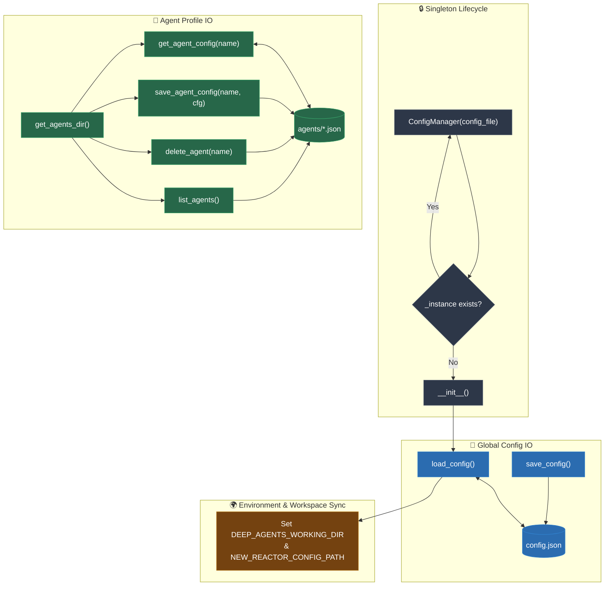

# Config Manager Architecture & Flowchart   
   
This document details the singleton architecture, file path resolution, and configuration lifecycle for `config_manager.py`.   
   
## Architecture Overview   
   
`ConfigManager` is implemented as a **thread-safe Singleton** (`__new__`) across the entire Foundry Qt / Foundry CLI ecosystem:   
- Holds the authoritative in-memory configuration dictionary (`self.config`).   
- Bridges between global settings in `config.json` and individual agent profiles in `agents/{agent_name}.json`.   
- Resolves application directories, workspace paths, and environment variables (`DEEP_AGENTS_WORKING_DIR`, `NEW_REACTOR_CONFIG_PATH`).   
   
---   
   
## Flowchart   
   

   
---   
   
## Method Reference & State Interactions   
   
| Method | Trigger / Caller | Downstream Calls / Operations | Files / Environment Modified |
| :--- | :--- | :--- | :--- |
| `__new__()` | Instantiation in `main.py`, `repl.py`, `SettingsDialog`, `AgentManagerDialog` | Returns singleton instance `_instance`. | In-memory singleton pointer. |
| `__init__()` | First instantiation | Sets defaults, computes `app_dir` and `config_file`, calls `load_config()`. | Initializes `self.config` dict. |
| `load_config()` | `__init__()` | Reads JSON, migrates legacy split IPs, syncs session keys, sets env vars. | `os.environ["DEEP_AGENTS_WORKING_DIR"]`, `os.environ["NEW_REACTOR_CONFIG_PATH"]`. |
| `save_config()` | `settings.py`, `agent_manager.py`, `mainwindow.py` | Serializes `self.config` with indentation. | Writes `config.json`. |
| `get_agents_dir()` | Agent listing and CRUD methods | Computes `{da_root_dir}/../agents`, ensures directory exists via `os.makedirs`. | Creates `agents/` folder if missing. |
| `list_agents()` | Combos in `agent_manager.py`, `mainwindow.py`, `settings.py` | Scans `agents/` directory for `.json` files. | None (Read-only). |
| `get_agent_config()` | `setup_llm()`, `GenerationThread`, dialog initializations | Reads and parses `{name}.json`. | Reads `agents/{name}.json`. |
| `save_agent_config()` | Agent Manager edits, preset saving, tool toggles | Writes formatted JSON to `{name}.json`. | Writes `agents/{name}.json`. |
| `delete_agent()` | Delete button in Agent Manager or Settings | Deletes `{name}.json` from disk. | Unlinks `agents/{name}.json`. |
