# Core Engine Architecture & Flowchart   
   
This document details the central execution pipeline, LLM client generation, prompt construction, and DeepAgents integration in `core_engine.py`.   
   
## Architecture Overview   
   
`core_engine.py` is the execution backbone for both the GUI (`mainwindow.py` / `generation_thread.py`) and CLI (`repl.py`):   
- **Reasoning-Aware LLM Client**: Subclasses `ChatOpenAI` into `ChatOpenAIWithReasoning` to extract non-standard `reasoning_content` / `reasoning` chunks from local engines (vLLM, llama.cpp, Unsloth Studio, DeepSeek).   
- **Message Sanitization & Normalization**: `wrap_llm_to_clean_null_messages()` merges consecutive messages with the same role and formats tool calls/results into OpenAI-compliant turns.   
- **Context Injection**: `build_system_prompt()` dynamically compiles personas, current time, memory vault snippets, LightRAG contexts, staged file contents, and enabled tools.   
- **DeepAgents Factory**: `setup_deep_agent()` configures backends, subagents, SQLite checkpointers (`agent_checkpoints.db`), harness profile exclusions, and middleware.   
   
---   
   
## Function Call & Data Flowchart   

```mermaid
flowchart TD
    %% Styling
    classDef client fill:#2d3748,stroke:#4a5568,color:#fff
    classDef prompt fill:#2b6cb0,stroke:#3182ce,color:#fff
    classDef da fill:#276749,stroke:#38a169,color:#fff
    classDef helper fill:#744210,stroke:#b7791f,color:#fff
    classDef ext fill:#4a5568,stroke:#718096,color:#fff

    subgraph LLMFactory ["🔌 LLM Setup & Message Sanitization"]
        setup_llm["setup_llm(config, agent_cfg, overrides)"]:::client
        extract_rc["_extract_reasoning(dict)"]:::helper
        custom_llm["ChatOpenAIWithReasoning\n(extracts reasoning_content)"]:::client
        google_llm["ChatGoogleGenerativeAI\n(Gemini backend)"]:::client
        wrap_clean["wrap_llm_to_clean_null_messages()"]:::helper
    end

    subgraph PromptCompilation ["📝 System Prompt Compilation"]
        build_prompt["build_system_prompt(...)"]:::prompt
        hook_pre["Execute 'on_pre_generation_prompt' hook"]:::helper
        get_tools_fn["get_tools(config, agent_cfg)"]:::helper
        scratchpad_inj["Inject Scratchpad Data"]:::helper
        vault_inj["Query Memory Vault (pre_generation_retrieval)"]:::helper
        rag_inj["Query LightRAG Knowledge Base (/query)"]:::helper
        files_inj["Inject Staged File Contents"]:::helper
        tools_inj["Inject Tool & Subagent Documentation"]:::helper
    end

    subgraph DeepAgentsFactory ["🧠 DeepAgents Configuration"]
        setup_da["setup_deep_agent(llm, tools, sys_prompt, ...)"]:::da
        backend_cfg["Instantiate Backend (Filesystem/LocalShell/State)"]:::da
        subagents_cfg["Load and Filter Subagents (agents/*.json)"]:::da
        checkpointer_cfg["SqliteSaver (agent_checkpoints.db)"]:::da
        harness_cfg["Register HarnessProfile (excluded_tools)"]:::da
        middleware_cfg["Configure Middleware (tools, memory, skills)"]:::da
        create_da["create_deep_agent(...)"]:::da
    end

    subgraph ExternalServices ["🌐 External Storage & Endpoints"]
        llm_server["Inference Server (vLLM / LM Studio / OpenAI)"]:::ext
        lightrag_srv["LightRAG Server (/query)"]:::ext
        vault_files[("memory_vault/*.md")]:::ext
        db_chk[("agent_checkpoints.db")]:::ext
    end

    %% LLM Setup Flow
    setup_llm --> custom_llm
    setup_llm --> google_llm
    custom_llm --> extract_rc
    custom_llm --> wrap_clean
    google_llm --> wrap_clean
    wrap_clean --> llm_server

    %% Prompt Flow
    build_prompt --> hook_pre
    build_prompt --> get_tools_fn
    build_prompt --> scratchpad_inj
    build_prompt --> vault_inj
    build_prompt --> rag_inj
    build_prompt --> files_inj
    build_prompt --> tools_inj
    vault_inj --> vault_files
    rag_inj --> lightrag_srv

    %% DeepAgent Setup Flow
    setup_da --> backend_cfg
    setup_da --> subagents_cfg
    setup_da --> checkpointer_cfg
    setup_da --> harness_cfg
    setup_da --> middleware_cfg
    checkpointer_cfg --> db_chk
    setup_da --> create_da
```   
   

   
---   
   
## Core Function Reference Table   
   
| Function | Callers | Internal Operations | Output / State Produced |
| :--- | :--- | :--- | :--- |
| `setup_llm()` | `GenerationThread`, `repl.py`, `_bulk_rename_sessions` | Merges inference parameters, selects Google or OpenAI provider, injects reasoning flags, applies `wrap_llm_to_clean_null_messages`. | Instantiated LangChain LLM Runnable with streaming enabled. |
| `wrap_llm_to_clean_null_messages()` | `setup_llm()` | Intercepts `invoke` & `stream`, normalizes message types, merges consecutive roles, strips empty/null turns. | Wrapped LLM instance. |
| `get_tools()` | `build_system_prompt()`, `setup_deep_agent()`, `GenerationThread` | Reads `enabled_tools`, inspects functions from `toolz.py`, filters available members. | List of callable Python functions for LangChain/DeepAgents. |
| `build_system_prompt()` | `GenerationThread.run()`, `ReplApp.setup_agent()` | Formats critical temporal reality instructions, queries Memory Vault, queries LightRAG, inlines staged files, attaches tool docs. | Fully compiled system prompt string. |
| `setup_deep_agent()` | `GenerationThread.run()`, `ReplApp.setup_agent()` | Configures backend pathing, loads subagent JSONs, attaches SQLite checkpointer, registers tool loop harness. | Compiled LangGraph / DeepAgent runnable graph. |
| `_extract_reasoning()` | `ChatOpenAIWithReasoning` chunk & message callbacks | Inspects deltas for `reasoning_content` (llama.cpp/Unsloth) or `reasoning` (vLLM). | Extracted reasoning string stored in `additional_kwargs`. |
