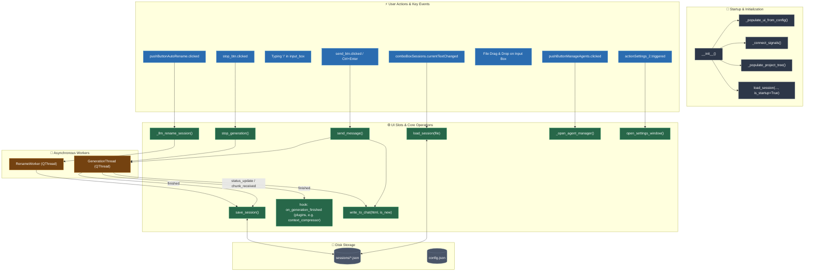

# MainWindow Architecture & Flowchart   
   
This document details the central GUI lifecycle, event filter management, docks, session persistence, and thread orchestration in `mainwindow.py`.   
   
## Architecture Overview   
   
`MstyCloneApp` (subclassing `QMainWindow`) is the graphical hub of Foundry Qt:   
- **WebEngine Chat Interface**: Uses `QWebEngineView` with JavaScript injection to dynamically render streamed HTML and markdown formatting.   
- **Multi-Dock Workspace**: Houses Context length counter, DeepAgents Todo dock, Scratchpad dock with file system watcher, and File Contents viewer tab widget.   
- **Staged File Drag-and-Drop**: Intercepts dragged files via event filters and manages file icons staged into LLM system prompts.   
- **Thread Orchestration**: Spawns `GenerationThread` for chats, `RenameWorker` for auto-renaming, and tracks thread lifecycles.   
- **Slash Commands**: Intercepts `/goal`, `/schedule`, `/browser`, `/continue`, `/compress`, etc. via `SlashCommandPopup`.   
   
---   
   
## Flowchart & Event Cascade   
   

   
---   
   
## Primary Slot & Event Reference Table   
   
| User Action / Event | Widget Signal | Slot Handler | Downstream Logic / State Modified |
| :--- | :--- | :--- | :--- |
| **Send Chat Message** | `send_btn.clicked` / `Ctrl+Enter` | `send_message()` | Appends to `self.messages`, renders user turn in WebEngine, spawns `GenerationThread`. |
| **Stop Generation** | `stop_btn.clicked` | `stop_generation()` | Sets `generation_thread.cancel_flag = True`, sends force-unload signal to server, resets UI inputs. |
| **Slash Commands** | Key release with `/` prefix | `eventFilter()` | Filters and positions `SlashCommandPopup`; plugin-owned commands (e.g. `/compress`) are dispatched from `send_message()` via the `on_slash_command` hook. |
| **Switch Session** | `comboBoxSessions.currentTextChanged` | `comboBoxSessionsSignal()` $\rightarrow$ `load_session()` | Reads JSON from `sessions/`, restores `self.messages`, populates chat HTML view. |
| **Auto Rename** | `pushButtonAutoRename.clicked` | `_llm_rename_session()` | Spawns `RenameWorker` with lightweight worker agent (`reactor_worker`) to generate title. |
| **Context Compression** | Automatic threshold or `/compress` | `plugins/context_compressor_plugin.py` (via `on_generation_finished` / `on_slash_command`) | Built-in compressor removed. Plugin summarizes all but the last N messages, replaces head of `self.messages`, emits `context_compressed_signal` which updates context counter and auto-saves session to file. |   
| **Drag & Drop Staging** | `QEvent.Drop` on `input_box` | `eventFilter()` | Adds file to `self.staged_files`, displays icon in staging indicator bar, updates context counter. |
| **Open Agent Manager** | `pushButtonManageAgents.clicked` | `_open_agent_manager()` | Spawns singleton instance of `AgentManagerDialog`, refreshes models on close. |
| **Open Settings** | `actionSettings_2.triggered` | `open_settings_window()` | Spawns `SettingsDialog`. |

---   
   
## Plugin Hooks Fired by MainWindow   
   
| Hook | Type | Fired From | Signature | Return |
| :--- | :--- | :--- | :--- | :--- |
| `on_generation_finished` | event | `_on_generation_finished()` | `cb(full_response)` | `False` short-circuits later hooks. |
| `on_slash_command` | string | `send_message()` when input starts with `/` | `cb(current, command=str, **kw)` | `"HANDLED"` consumes the input (cleared, no generation). Anything else falls through. |
