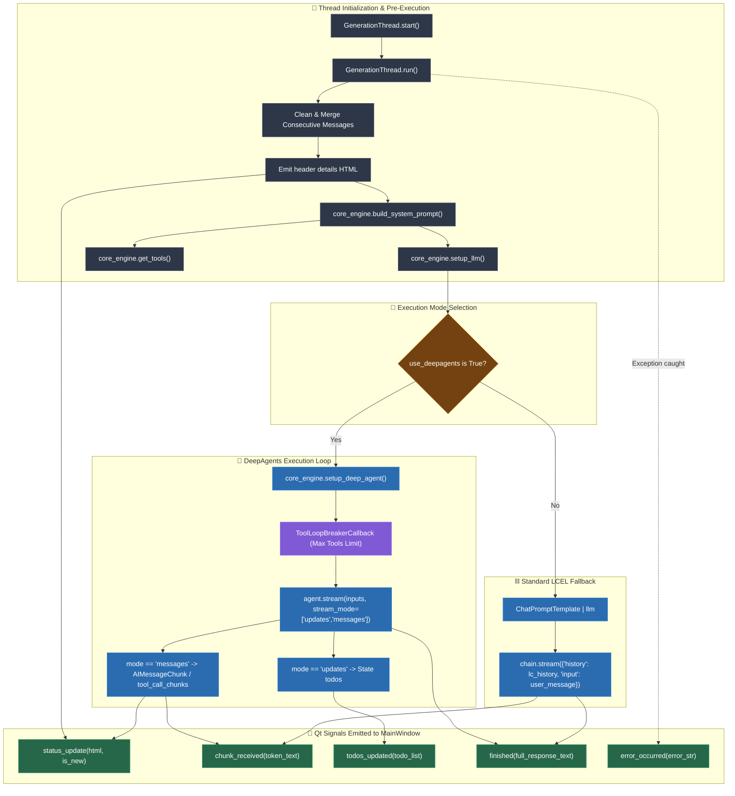

# Generation Thread Architecture & Flowchart   
   
This document details the background threading, streaming execution, tool looping, and GUI signaling logic in `generation_thread.py`.   
   
## Architecture Overview   
   
`GenerationThread` inherits from PyQt5's `QThread`. It isolates all network IO, streaming token processing, and agentic tool loop executions from the Qt main event loop:   
- **Pre-execution Sanitization**: Merges consecutive messages of identical roles and compiles dynamic context before connecting to the model.   
- **Branching Execution Paths**:   
  - **DeepAgents Path**: Invokes compiled LangGraph agent using dual streaming modes (`updates` for todos, `messages` for chunks and tool calls).   
  - **LCEL Fallback Path**: Standard LangChain Expression Language chain (`prompt | llm`) for non-agent models.   
- **Loop Breaker Safety**: Implements `ToolLoopBreakerCallback` to interrupt runaway agents that exceed `max_sequential_tool_calls`.   
- **Reasoning Tag Formatting**: Wraps thinking/reasoning deltas in `<think>...</think>` tags for display in the WebEngine chat view.   
   
---   
   
## Flowchart & Signal Cascades   
   

   
---   
   
## Thread Signal Reference Table   
   
| Signal | Signature | Emitted When | Connected Slot in `MainWindow` |
| :--- | :--- | :--- | :--- |
| `status_update` | `(str text, bool is_new)` | Header line, status notifications, memory vault searches, tool invocations | `self.write_to_chat` |
| `chunk_received` | `(str token)` | Streamed tokens of reasoning or generated assistant response text | `lambda t: self.write_to_chat(t, False)` |
| `todos_updated` | `(list todos)` | DeepAgent emits state updates containing todos | `self._on_todos_updated` |
| `finished` | `(str response)` | LLM generation completes successfully | `self._on_generation_finished` |
| `error_occurred` | `(str error)` | Uncaught exception or model connection error | `self._on_generation_error` |
