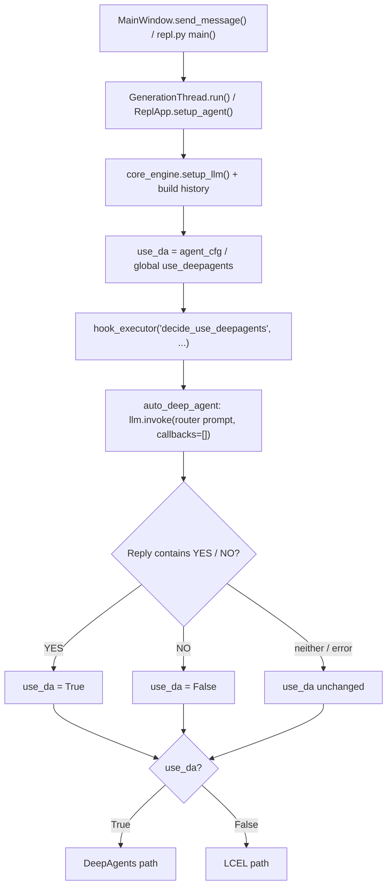

# Auto Deep Agent Plugin Walkthrough   
   
## Purpose   
   
DeepAgents (tools, skills, planning, sub-agents) is powerful but slower and heavier than a plain LCEL chat. The **Auto Deep Agent** plugin lets the active model decide, per message, whether DeepAgents is actually needed.   
   
Before each generation, the model is shown the user's message and asked:   
   
> Given the user's message, are tools and/or skills (DeepAgents) needed? Reply **YES** if needed, **NO** if you can confidently answer directly.   
   
- **YES** → DeepAgents is enabled for this run.   
- **NO** → DeepAgents is disabled for this run (plain LCEL path).   
- Failure / no YES or NO found → the normal setting (agent config → global checkbox) is used.   
   
The decision is **per-run only**; `config.json` and the DeepAgents checkbox are never modified.   
   
---   
   
## Files Changed   
   
| File | Change |
| :--- | :--- |
| `plugins/auto_deep_agent_plugin.py` | **New.** Plugin: router hook, config tab, GUI & CLI (`enable_cli_plugin`) lifecycle. |
| `generation_thread.py` | Added `decide_use_deepagents` hook call right before the DeepAgents/LCEL branch. |
| `repl.py` | Added `execute_string_hook`, `decide_use_deepagents` hook call in `setup_agent`, and LCEL fallback in `execute` when `use_da=False`; loads CLI plugins before `setup_agent`. |
| `documentation/execution_flow_charts/generation_thread_flow.md` | Flowchart node + "Plugin Hooks Invoked by the Thread" reference section. |
| `documentation/execution_flow_charts/repl_flow.md` | Updated plugin loading order, `decide_use_deepagents` hook, and LCEL execution fallback. |
| `CHANGELOG.md` | Added entries for the plugin and hook. |
   
---   
   
## Flow   
   

   
---   
   
## The Hook (`generation_thread.py` & `repl.py`)   
   
`decide_use_deepagents` is a string hook executed via `MainWindow.execute_string_hook` (GUI) or `ReplApp.execute_string_hook` (CLI). It is skipped for `reactor_worker`.   
   
| kwarg | Description |
| :--- | :--- |
| `user_message` | Latest user message text |
| `llm` | The already-configured main LangChain LLM (reused, no extra setup) |
| `history` | LangChain message history (excluding the latest message) |
| `default` | Bool resolved from agent/global config |
| `status_update(msg, is_new)` | Emits HTML to the chat display (GUI) or stripped text to STDERR (CLI) |
| `cancel_flag_func()` | Returns `True` if the user pressed Stop |
   
Return `"YES"` / `"NO"` to override; anything else keeps the default. Multiple plugins can chain — the plugin respects a prior `YES`/`NO` from a higher-priority hook.   
   
**Performance**: with no hook registered the overhead is microseconds. With the plugin enabled, each message costs one extra (short) LLM round-trip.   
   
---   
   
## The Plugin (`plugins/auto_deep_agent_plugin.py`)   
   
### Enabling (GUI)   
Check **Auto Deep Agent** in the plugins menu. This:   
1. Adds an **"Auto Deep Agent"** tab to the main `tabs` widget.   
2. Registers the `decide_use_deepagents` hook (priority 50).   
   
Unchecking removes the tab and unregisters the hook — no remnants.   
   
### Enabling (CLI — `repl.py`)   
Pass `--plugins auto_deep_agent` (or `--plugins auto_deep_agent_plugin`) to `repl.py`:   
```bash
bin/python repl.py --plugins auto_deep_agent "What is 2+2?"
```
`enable_cli_plugin(repl_app)` registers the same `decide_use_deepagents` hook on `ReplApp`, reading `auto_deep_agent_prompt`, `auto_deep_agent_include_history`, and `auto_deep_agent_agent` from `config.json` and logging the decision (`[🤖 Auto Deep Agent: DeepAgents ENABLED 🧠]` / `DISABLED 💬`) to `STDERR` while keeping `STDOUT` clean for Unix piping.   
   
### Config Tab   
- **Agent used for the YES/NO decision** — `(Current Agent)` (default) reuses the main run's LLM. Picking another agent builds the router LLM from that agent's endpoint + model via `core_engine.setup_llm` (temperature 0). Only the endpoint/model are used, not its prompt or tools. Saved as `auto_deep_agent_agent`.   
- **Include recent conversation history** — sends the last 4 messages (truncated to 500 chars each) along with the user message for better routing on follow-ups. Saved as `auto_deep_agent_include_history`.   
- **Router Prompt** — editable YES/NO classifier prompt. Saved live as `auto_deep_agent_prompt`.   
- **Reset to Default Prompt** — restores the built-in prompt.   
   
### Chat / STDERR Feedback   
A single status line appears per message:   
- `[🤖 Auto Deep Agent: DeepAgents ENABLED 🧠]`   
- `[🤖 Auto Deep Agent: DeepAgents DISABLED 💬]`   
- `[⚠️ Auto Deep Agent: classifier failed, using default (ON/OFF)]`   
   
### Implementation Notes   
- The router call uses `config={"callbacks": []}` so its output never leaks into the main chat stream.   
- `<think>...</think>` blocks are stripped before searching for the first `YES`/`NO` token.   
- The hook runs on the generation thread (GUI) or in `ReplApp.setup_agent` (CLI); it reads settings from `app.config` (never from Qt widgets directly), and `PyQt5.QtWidgets` is imported lazily inside `enable_plugin`.   
   
---   
   
## Verification   
   
- `python3 -m py_compile plugins/auto_deep_agent_plugin.py generation_thread.py repl.py` → OK.   
- Manual test checklist:   
  1. Enable the plugin in GUI (or pass `--plugins auto_deep_agent` in CLI).   
  2. Ask "What is 2+2?" → expect `DISABLED 💬`, plain LCEL response.   
  3. Ask "Read main.py and summarize it" → expect `ENABLED 🧠`, DeepAgents path.   
  4. Disable the plugin → tab disappears, behavior reverts to the checkbox.   

