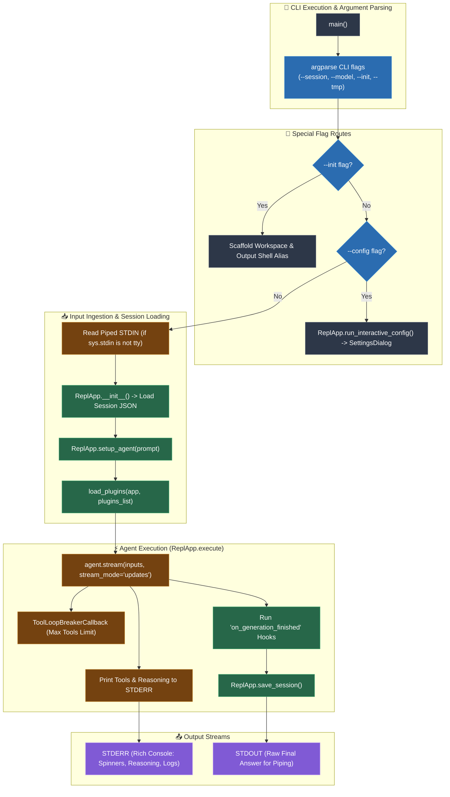

# REPL (Foundry CLI) Architecture & Flowchart   
   
This document details the command-line interface execution flow, Unix pipeline integration, standard stream separation, and plugin management in `repl.py`.   
   
## Architecture Overview   
   
`repl.py` provides the headless CLI / REPL interface (`Foundry CLI`) for one-shot runs, scripts, and shell pipelines:   
- **Clean Standard Stream Separation**: All diagnostics, spinners, tool logs, and reasoning blocks are routed strictly to `STDERR` via Rich `err_console`. `STDOUT` is preserved exclusively for the final answer, enabling standard Unix piping (`ai++ "..." | jq`).   
- **Piped Stdin Ingestion**: Detects non-TTY inputs (`not sys.stdin.isatty()`) and inlines piped text into prompt input.   
- **Session Continuity**: Supports `--session`, `--tmp`, and `--continue` flags, saving formatted session JSON compatible with the GUI.   
- **Project Bootstrapping**: `--init` generates workspace scaffolding and outputs shell aliases for easy terminal use.   
   
---   
   
## Flowchart & Pipeline Architecture   
   

   
---   
   
## Method & CLI Flag Reference Table   
   
| CLI Argument / Method | Purpose / Description | Downstream Methods Called | Stream / File Affected |
| :--- | :--- | :--- | :--- |
| `main()` | Entrypoint for the CLI script. | `ConfigManager`, `ReplApp`, `load_plugins` | CLI invocation. |
| `--init` | Scaffolds workspace folder, copies default config, prints alias. | `shutil.copy`, `os.makedirs` | Creates `agent_space/`, outputs bash alias to STDOUT. |
| `--config` | Spawns GUI settings window directly from terminal. | `SettingsDialog(app)` | Spawns PyQt5 settings interface. |
| `--test-config` | Prints active in-memory configuration JSON and exits. | `json.dumps(config)` | Outputs to STDOUT. |
| `--tmp` | Generates a timestamped temporary session file for one-shot runs. | `json.dump([], f)` | Creates `sessions/tmp_*.json`. |
| `setup_agent()` | Builds system prompt and instantiates DeepAgent graph for prompt. | `core_engine.setup_llm`, `build_system_prompt`, `setup_deep_agent` | Prepares `self.agent`. |
| `execute()` | Executes LangGraph stream, tracks tool loops, fires finish hooks. | `agent.stream()`, `save_session()` | Logs to STDERR; returns final response for STDOUT. |
| `save_session()` | Exports session messages with HTML formatting compatible with GUI. | Writes JSON to disk | Updates `sessions/*.json`. |
