# Settings Dialog Architecture & Flowchart   
   
This document details the configuration dialog lifecycle, tabs, bulk session renamer threading, and persistence logic in `settings.py`.   
   
## Architecture Overview   
   
`SettingsDialog` (subclassing `QWidget`) provides global preferences, external service endpoints, and maintenance controls:   
- **Multi-Tab Architecture**: Organizes LightRAG endpoints, LM Studio connectivity, global models, inference sliders, session management, and runtime toggles.   
- **Auto-Save Mechanism**: UI input elements (sliders, text fields, checkboxes) auto-save directly to `config.json` via `_push_save()` without requiring an explicit save button.   
- **Bulk Session Renamer Thread**: `BulkSessionRenamerThread` runs asynchronously to batch-rename default session files using an LLM worker (`reactor_worker`) without locking the UI.   
- **Maintenance Actions**: Provides checkpoint cleanup (`_clear_checkpoint_db`) and agent manager dialog launching.   
   
---   
   
## Flowchart & Signal Architecture   

```mermaid
flowchart TD
    %% Styling
    classDef init fill:#2d3748,stroke:#4a5568,color:#fff
    classDef signal fill:#2b6cb0,stroke:#3182ce,color:#fff
    classDef core fill:#276749,stroke:#38a169,color:#fff
    classDef thread fill:#744210,stroke:#b7791f,color:#fff
    classDef ext fill:#4a5568,stroke:#718096,color:#fff

    subgraph DialogBootstrap ["🚀 Dialog Initialization"]
        init["__init__(parent_app)"]:::init
        pop_ui["_populate_ui_from_config()"]:::init
        conn_sig["_connect_signals()"]:::init
        sync_pre["_sync_preset_combobox()"]:::init
    end

    subgraph UISignals ["⚡ User Actions & Tab Signals"]
        evt_lightrag["LightRAG Add / Remove / Select"]:::signal
        evt_lms["LMStudio Add / Remove / Select"]:::signal
        evt_models["model_combo / fetch buttons"]:::signal
        evt_sliders["Inference Sliders valueChanged"]:::signal
        evt_runtime["Runtime Toggles & Inputs stateChanged"]:::signal
        evt_sessions["Session Add / Remove / Select"]:::signal
        evt_bulk_rename["pushButtonSessionsRename.clicked"]:::signal
        evt_clear_cp["pushButtonClearCheckpointDb.clicked"]:::signal
        evt_open_agent_mgr["pushButtonAgentsManage.clicked"]:::signal
    end

    subgraph HandlersAndLogic ["⚙️ Slot Handlers & Operations"]
        on_lightrag["_add_lightrag_url / _remove / _select"]:::core
        on_lms["_add_lmstudio / _remove / _select"]:::core
        on_models["_on_model_selected / _fetch_lms_models"]:::core
        upd_sliders["_update_slider_labels()"]:::core
        on_runtime["_on_runtime_settings_changed()"]:::core
        on_sessions["_add_session / _remove / _select"]:::core
        bulk_rename["_bulk_rename_sessions()"]:::core
        clear_cp["_clear_checkpoint_db()"]:::core
        open_agent_mgr["_open_agent_manager()"]:::core
        push_save["_push_save() -> config_manager.save_config()"]:::core
    end

    subgraph AsyncWorker ["🧵 Asynchronous Worker Thread"]
        renamer_th["BulkSessionRenamerThread (QThread)"]:::thread
    end

    subgraph DiskStorage ["💾 Filesystem & Config"]
        cfg_file[("config.json")]:::ext
        chk_files[("agent_checkpoints*")]:::ext
        sess_files[("sessions/*.json")]:::ext
    end

    %% Init Flow
    init --> pop_ui
    init --> conn_sig
    pop_ui --> sync_pre

    %% Signal Connections
    evt_lightrag --> on_lightrag
    evt_lms --> on_lms
    evt_models --> on_models
    evt_sliders --> upd_sliders
    evt_runtime --> on_runtime
    evt_sessions --> on_sessions

    %% Auto-save Convergence
    on_lightrag --> push_save
    on_lms --> push_save
    on_models --> push_save
    upd_sliders --> push_save
    on_runtime --> push_save
    on_sessions --> push_save
    push_save --> cfg_file

    %% Special Operations
    evt_bulk_rename --> bulk_rename
    bulk_rename --> renamer_th
    renamer_th --> sess_files

    evt_clear_cp --> clear_cp
    clear_cp --> chk_files

    evt_open_agent_mgr --> open_agent_mgr
```   
   

   
---   
   
## Slot & Method Reference Table   
   
| User Action / UI Trigger | Signal | Slot Handler | Downstream Logic / State Modified |
| :--- | :--- | :--- | :--- |
| **Manage Agents Button** | `pushButtonAgentsManage.clicked` | `_open_agent_manager()` | Spawns `AgentManagerDialog` and connects `destroyed` signal to refresh list. |
| **Slider Adjustments** | `*_slider.valueChanged` | `_update_slider_labels()` | Updates numeric text labels, saves parameters to `config.json`. |
| **Runtime Settings** | Checkboxes / Spinboxes | `_on_runtime_settings_changed()` | Updates semantic LTM, context compression thresholds, DA root dir and backend. |
| **LightRAG Management** | Add / Remove buttons / List click | `_add_lightrag_url()`, `_remove_lightrag_url()`, etc. | Updates `saved_lightrag_urls`, active URL, descriptions map in `config.json`. |
| **LM Studio Endpoints** | Add / Remove buttons / List click | `_add_lmstudio()`, `_remove_lmstudio()` | Updates `saved_lmstudio_urls` and active URL. |
| **Bulk Session Rename** | `pushButtonSessionsRename.clicked` | `_bulk_rename_sessions()` | Spawns `BulkSessionRenamerThread` using `reactor_worker` to rename default timestamped sessions. |
| **Clear Checkpoints** | `pushButtonClearCheckpointDb.clicked` | `_clear_checkpoint_db()` | Finds and deletes `agent_checkpoints*` SQLite DB and WAL files from the workspace parent directory. |
| **Preferences Fields** | Text fields `textChanged` | `_save_preferences()` | Updates editor command and file manager commands in config. |
